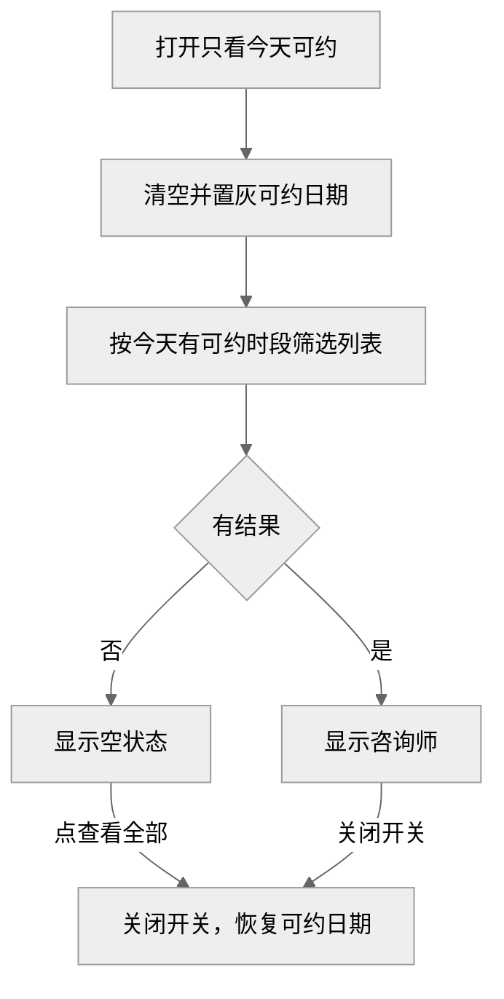
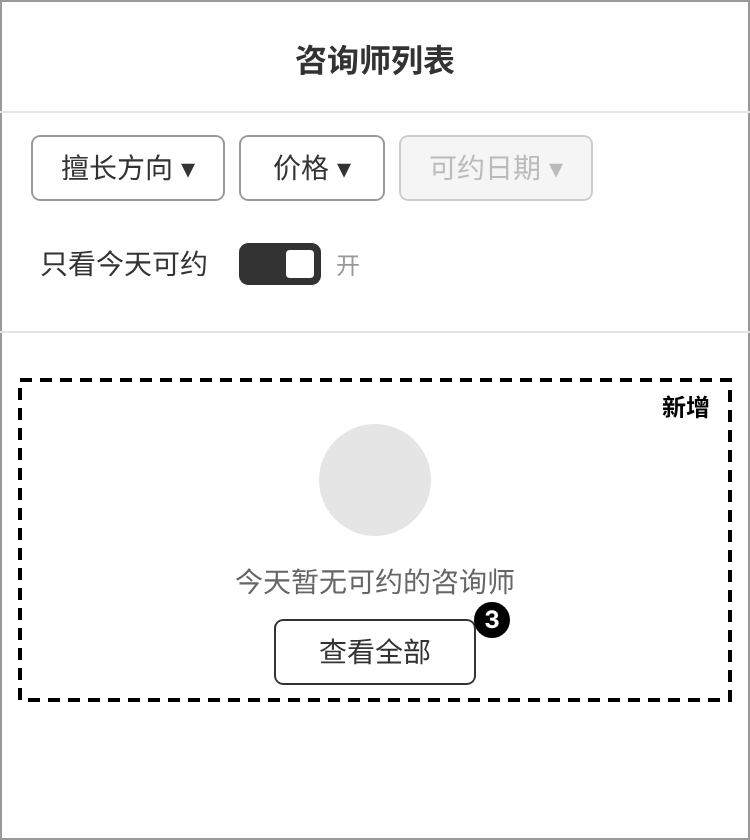

# 咨询师列表增加只看今天可约 PRD

咨询师列表加一个开关，打开后只显示今天还能约的咨询师。

## 需求变更记录

| 版本号 | 变更日期 | 变更人 | 变更类型 | 涉及章节 | 变更内容 |
| --- | --- | --- | --- | --- | --- |
| v1.0 | 11 月 5 日 | 陈越 | 新增 | 全文 | 首版 |

## 一、背景与问题

- **定位**：咨询师列表的筛选能力，服务想当天咨询的来访者。
- **问题**：想当天咨询的来访者要逐个进详情才知道今天能不能约。
- **来源**：客服反馈

## 三、目标

| 指标 | 类型 | 现状 | 目标 | 达成时间 |
| --- | --- | --- | --- | --- |
| 列表到选择时段页的转化率 | 核心 | 18% | 22% | 上线后 2 周 |

## 八、需求详情

### 8.1 功能清单

| 编号 | 功能 | 模块 | 优先级 | 一句话说明 |
| --- | --- | --- | --- | --- |
| F-01 | 只看今天可约 | 咨询师 | P1 | 列表新增筛选开关 |

### 8.2 业务流程

### 8.4 页面说明

#### F-01 咨询师列表

**线框图**

**入口**：不变。

**操作与规则**

- ① 只看今天可约：打开后只显示今天还有可约时段的咨询师，可与其他筛选组合；关闭后恢复原结果。
- ② 可约日期：开关打开时清空并置灰。
- ③ 查看全部：关闭开关，显示全部结果。

**字段与组件**

| 编号 | 字段 / 组件 | 类型 | 必填 | 长度 / 格式 | 选项 / 来源 | 默认值 | 校验与提示 | 显示条件 |
| --- | --- | --- | --- | --- | --- | --- | --- | --- |
| ① | 只看今天可约 新增 | 开关·布尔 | 否 | | 开 / 关 | 关，离开页面后重置 | | |
| ② | 可约日期 修改 | 日期·日期 | 否 | 月日加星期 | | 不选 | | 改前一直可用 → 改后开关为关时可用 |
| ③ | 查看全部 新增 | 按钮 | 否 | | | | | 开关打开且无结果 |

## 十二、验收标准

| 功能 | 验收标准 |
| --- | --- |
| [F-01](#F-01) | 满足 ①–③；开关打开时，列表中每位咨询师今天都至少有 1 个可约时段 |

**回归范围**：列表原有筛选、排序、加载更多。

## 十四、风险与依赖

| 类型 | 描述 | 影响 | 应对 | 负责人 |
| --- | --- | --- | --- | --- |
| 依赖 | 列表接口返回今天是否可约 | 中 | 提测前完成接口改造 | 周凯 |
