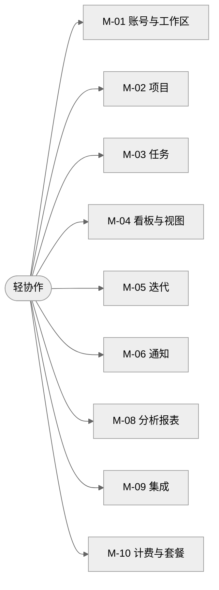
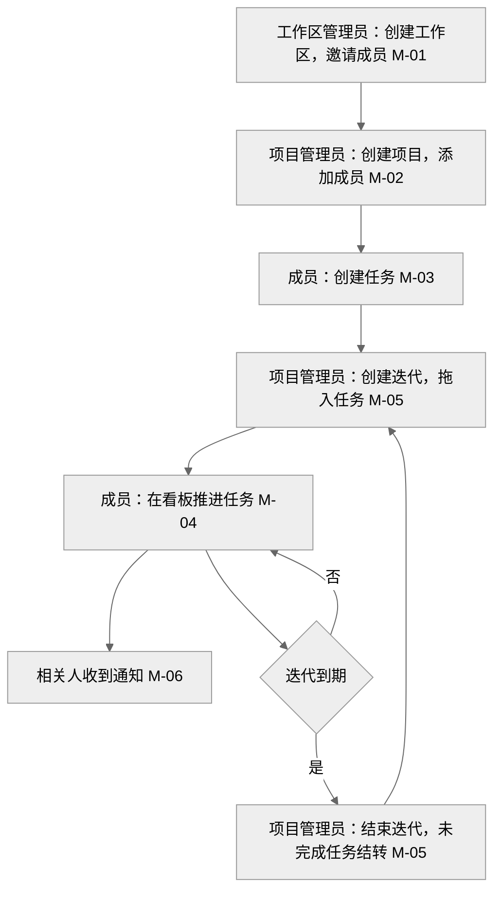
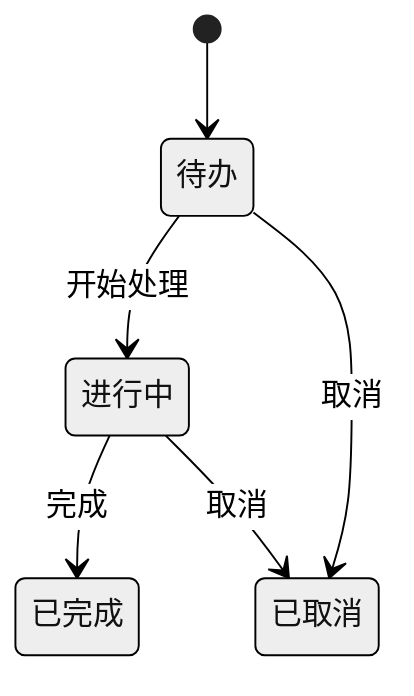
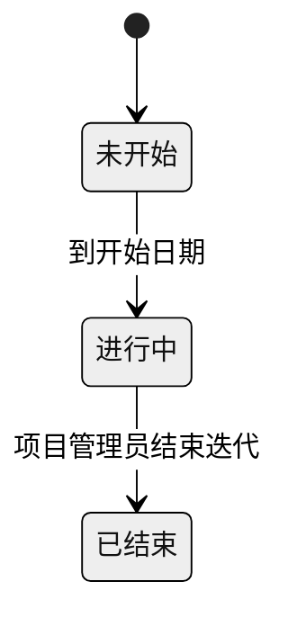

<!-- 示例：新产品模式。输入只有一句话，第 2 步用两轮确认补齐信息，然后直接写出总纲 v1.0。分隔线以上是对话中的确认过程，以下是交付的总纲。 -->

> **用户输入**：我想要做一个类似 Plane 的项目协同工具。
>
> **第 1 步**：Web 应用为主，SaaS 标品；行业通用；新产品模式，先出产品总纲；只要文本。

## 写 PRD 前需要确认 第 1 轮

1. 【一、二】和 Plane 相比最想做得不一样的是什么？建议：更轻、10 分钟上手，中文团队优先。
2. 【一】主要给谁用？建议：10-50 人的中小研发团队。
3. 【十】部署方式？建议：先做 SaaS，V2 再做私有化。
4. 【十】怎么收费？建议：10 人以内免费，超出按人每月 15 元。
5. 【九】MVP 范围？建议：账号、项目、任务、看板、迭代、通知，3 个月上线。
6. 【五】要不要项目内文档？建议：不做，用飞书等外部文档。
7. 【8.1】要不要英文界面？建议：MVP 只做中文。
8. 【十二】团队负责人？建议：给出产品、研发、测试、设计负责人姓名。

可以逐条回答，也可以回“全部按建议”。

> **用户**：1-7 按建议。产品林舟，研发何川，测试苏晴，设计方圆。

## 写 PRD 前需要确认 第 2 轮

1. 【三】北极星指标和目标？建议：周活跃团队数，MVP 上线 3 个月达到 300 个。
2. 【8.1】删除的项目保留多久？建议：回收站保留 30 天。
3. 【十一】性能要求？建议：单项目 5000 个任务时，看板 2 秒内加载完成。
4. 【十一】数据存在哪里？建议：只服务中国大陆用户，数据存在境内。
5. 【二】现在用什么工具，为什么现在做？建议：Jira 太重、表格跟不住进度；团队有 3 个月研发窗口，竞品中文体验不足。
6. 【三】阶段指标？建议：MVP 上线 30 天内 60% 的团队完成首个迭代。
7. 【九】各版本时间？建议：MVP 2 月 28 日，V1 5 月 31 日，V2 8 月 31 日。
8. 【8.2、十一、十三】默认交互和风险应对？建议：操作 5 秒内可撤销；桌面最小宽度 1280；支持 Chrome、Edge、Safari 最新两版；上线后 2 周访谈 20 个团队；邮件服务 1 月 15 日前签约。

> **用户**：全部按建议。

---

# 轻协作 产品总纲

面向 10-50 人中小研发团队的轻量项目协同工具，第一版做任务、看板和迭代，10 分钟上手。

## 需求变更记录

| 版本号 | 变更日期 | 变更人 | 变更类型 | 涉及章节 | 变更内容 |
| --- | --- | --- | --- | --- | --- |
| v1.0 | 11 月 5 日 | 林舟 | 新增 | 全文 | 首版 |

## 一、产品定位

- **定位**：为中小研发团队提供轻量的项目与任务协同，帮助他们按迭代稳定交付。
- **目标用户**：研发成员、项目负责人；产品、设计、测试同样参与任务。
- **核心价值**：上手快；中文团队习惯优先；小团队免费。
- **典型场景**：

| 编号 | 场景 |
| --- | --- |
| S-01 | 负责人创建项目并邀请成员 |
| S-02 | 成员创建任务、指派、更新状态 |
| S-03 | 团队规划迭代并在看板上推进 |
| S-04 | 负责人查看迭代进度 |

## 二、背景与竞品参考

- **要解决的问题**：中小团队用 Jira 配置太重，用表格又跟不住进度。
- **为什么现在做**：团队已有 3 个月研发窗口，竞品中文体验不足。

| 竞品 | 定位 | 优点 | 不足 | 我们的差异 |
| --- | --- | --- | --- | --- |
| Plane | 开源项目管理工具 | 可自部署，界面现代 | 中文资料少 | 中文优先，SaaS 开箱即用 |
| Jira | 企业级项目与缺陷管理 | 功能全，生态成熟 | 配置复杂，上手成本高 | 默认配置即可用 |
| Linear | 研发团队任务管理 | 速度快，体验好 | 无中文界面 | 中文界面，小团队免费 |

## 三、产品目标

| 指标 | 类型 | 目标 | 时间 |
| --- | --- | --- | --- |
| 周活跃团队数 | 北极星 | 300 个 | MVP 上线后 3 个月 |
| 团队完成首个迭代的比例 | 阶段指标 | 60% | MVP 上线后 30 天 |

- **非目标**：第一版不做缺陷专用流程、工时核算、插件市场、项目内文档。

## 四、用户角色与权限总览

| 角色 | 典型用户 |
| --- | --- |
| 工作区管理员 | 团队负责人 |
| 项目管理员 | 项目经理、技术负责人 |
| 成员 | 研发、产品、设计、测试 |
| 访客 | 外部协作方 |

| 模块 | 工作区管理员 | 项目管理员 | 成员 | 访客 |
| --- | --- | --- | --- | --- |
| [M-01](#M-01) 账号与工作区 | 管理 | 查看 | 查看 | 无 |
| [M-02](#M-02) 项目 | 管理 | 管理 | 使用 | 查看 |
| [M-03](#M-03) 任务 | 管理 | 管理 | 使用 | 查看 |
| [M-04](#M-04) 看板与视图 | 管理 | 管理 | 使用 | 查看 |
| [M-05](#M-05) 迭代 | 管理 | 管理 | 使用 | 查看 |
| [M-06](#M-06) 通知 | 使用 | 使用 | 使用 | 无 |

## 五、功能模块地图

| 编号 | 模块 | 主要功能 | 优先级 | 首次版本 | 依赖模块 | PRD 状态 |
| --- | --- | --- | --- | --- | --- | --- |
| M-01 | 账号与工作区 | 登录、工作区、成员与角色 | P0 | MVP | | 未开始 |
| M-02 | 项目 | 项目创建、设置、成员 | P0 | MVP | [M-01](#M-01) | 未开始 |
| M-03 | 任务 | 任务字段、状态、指派、评论 | P0 | MVP | [M-02](#M-02) | 未开始 |
| M-04 | 看板与视图 | 看板、列表、筛选 | P0 | MVP | [M-03](#M-03) | 未开始 |
| M-05 | 迭代 | 规划、进度、结转 | P0 | MVP | [M-03](#M-03) | 未开始 |
| M-06 | 通知 | 站内、邮件 | P1 | MVP | [M-03](#M-03) | 未开始 |
| M-08 | 分析报表 | 进度、燃尽图 | P1 | V1 | [M-05](#M-05) | 未开始 |
| M-09 | 集成 | 代码仓库、IM | P2 | V2 | [M-03](#M-03) | 未开始 |
| M-10 | 计费与套餐 | 套餐、支付 | P1 | V1 | [M-01](#M-01) | 未开始 |

## 六、核心业务流程

从建项目到完成一个迭代

## 七、核心对象与关系

| 对象 | 关键属性 | 关系 | 所在模块 |
| --- | --- | --- | --- |
| 工作区 | 名称、成员、套餐 | 包含项目 | [M-01](#M-01) |
| 成员 | 姓名、邮箱、角色 | 属于工作区，参与项目 | [M-01](#M-01) |
| 项目 | 名称、标识、成员 | 属于工作区，包含任务和迭代 | [M-02](#M-02) |
| 任务 | 标题、描述、状态、优先级、负责人、截止日期、标签 | 属于项目，可关联迭代，可有子任务 | [M-03](#M-03) |
| 迭代 | 名称、起止日期、状态 | 属于项目，包含任务 | [M-05](#M-05) |
| 视图 | 筛选条件、展示类型 | 属于项目或个人 | [M-04](#M-04) |

**核心对象状态**

任务

迭代

## 八、全局与交互规范

### 8.1 全局规则

| 编号 | 规则项 | 规则 |
| --- | --- | --- |
| G-01 | 术语 | 统一用工作区、项目、任务、迭代、视图 |
| G-02 | 时间 | 北京时间 |
| G-03 | 编号 | 任务编号为“项目标识-序号”，例如 WEB-12 |
| G-04 | 权限 | 按第四章；访客只读 |
| G-05 | 操作日志 | 任务关键字段变更记入活动记录 |
| G-06 | 数据保留 | 删除的项目进入回收站，保留 30 天 |
| G-07 | 并发 | 多人同时编辑同一任务，后保存者提示冲突 |
| G-08 | 语言 | 只做中文 |

### 8.2 通用交互

| 编号 | 规范项 | 规范 |
| --- | --- | --- |
| I-01 | 列表 | 按更新时间倒序，可筛选、排序、分组 |
| I-02 | 页面状态 | 空项目、空迭代显示引导操作 |
| I-03 | 操作反馈 | 删除二次确认，其余操作即时生效，5 秒内可撤销 |
| I-04 | 表单 | 新建任务只要求标题 |
| I-05 | 导航 | 任务详情在右侧滑出，不离开看板 |
| I-06 | 适配 | 桌面浏览器，最小宽度 1280；移动端只读 |

## 九、MVP 与版本路线图

| 版本 | 目标 | 包含模块 | 时间 |
| --- | --- | --- | --- |
| MVP | 小团队完整跑通一个迭代 | [M-01](#M-01) 至 [M-06](#M-06) | 2 月 28 日 |
| V1 | 管理者看清进度，开始收费 | [M-08](#M-08)、[M-10](#M-10) | 5 月 31 日 |
| V2 | 减少工具切换，支持私有化 | [M-09](#M-09) | 8 月 31 日 |

**模块 PRD 撰写顺序**：1. M-01：所有模块依赖它　2. M-02　3. M-03：核心对象最多　4. M-04　5. M-05　6. M-06

## 十、商业模式与部署

- **收费方式**：10 人以内免费；超出按人每月 15 元
- **部署方式**：SaaS；V2 支持私有化

## 十一、非功能需求总则

| 类别 | 要求 |
| --- | --- |
| 性能 | 单项目 5000 个任务时，看板 2 秒内加载完成 |
| 安全 | 工作区之间数据隔离 |
| 隐私与合规 | 只服务中国大陆用户，数据存储在境内 |
| 兼容性 | 最新两个版本的 Chrome、Edge、Safari |

## 十二、团队与协作

| 角色 | 姓名 | 负责模块 |
| --- | --- | --- |
| 产品 | 林舟 | 全部 |
| 研发 | 何川 | 全部 |
| 测试 | 苏晴 | 全部 |
| 设计 | 方圆 | 全部 |

**外部依赖**：邮件发送服务，用于 [M-06](#M-06)。

## 十三、风险与依赖

| 类型 | 描述 | 影响 | 应对 | 负责人 |
| --- | --- | --- | --- | --- |
| 风险 | 与成熟工具正面竞争 | 高 | MVP 只做核心流程，上线后 2 周访谈 20 个团队 | 林舟 |
| 依赖 | 邮件发送服务 | 中 | 1 月 15 日前完成签约 | 何川 |

## 附录

### A. 名词解释

| 名词 | 解释 |
| --- | --- |
| 迭代 | 固定周期内计划完成的一批任务 |
| 视图 | 保存下来的筛选、分组和展示方式 |
