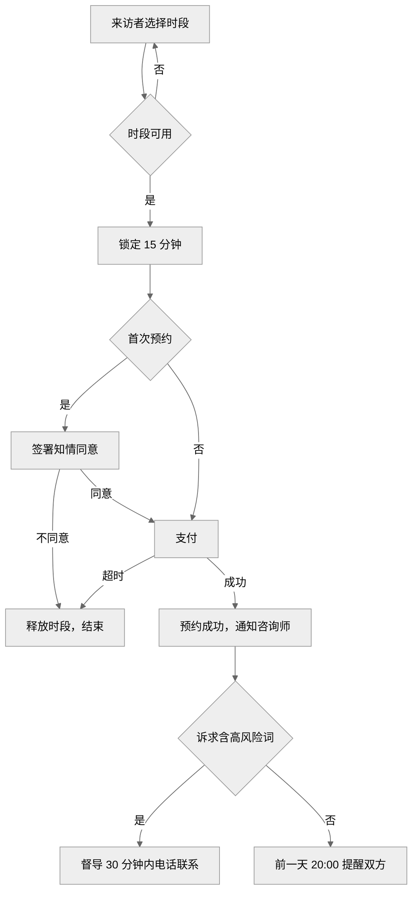
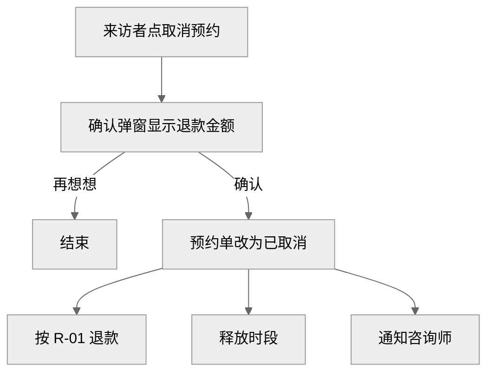
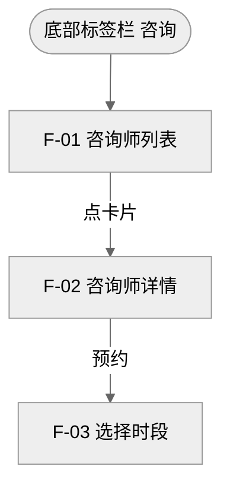
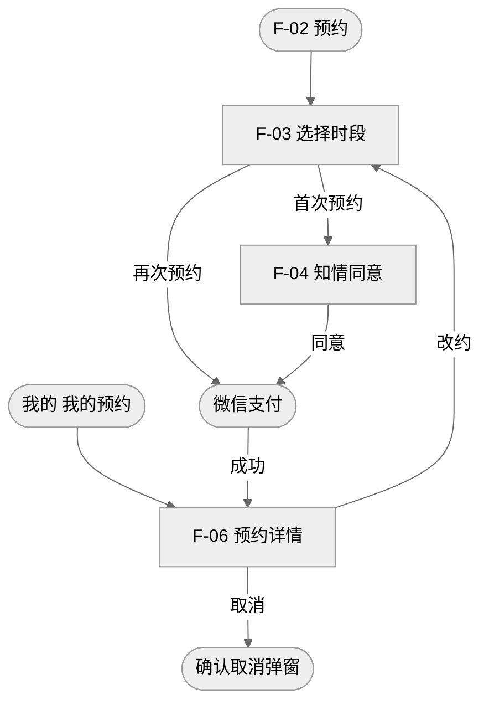
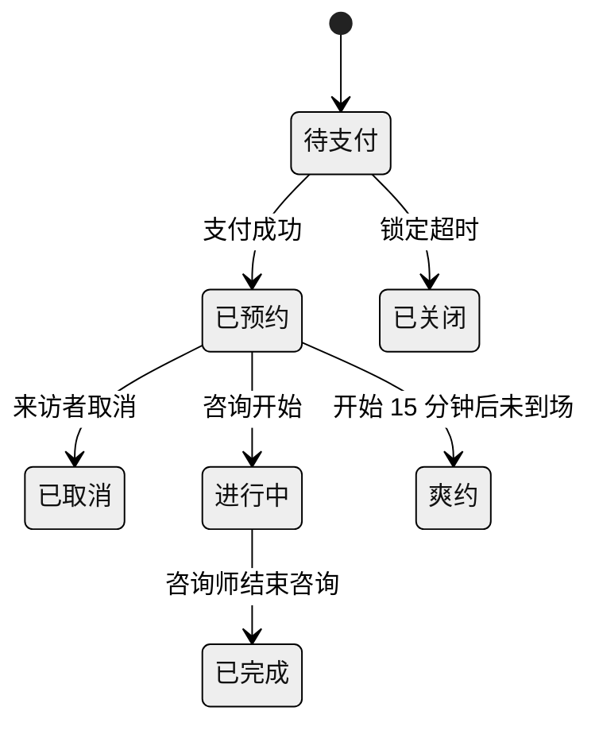

<!-- 示例：caffrey-prd-plus 核心版，只要文本。同一需求的完整版见 example-psych-booking.md。分隔线以上是对话中的确认过程，以下是交付的 PRD。 -->

> **用户输入**：心理咨询小程序要加一个在线预约咨询师的功能，用户能看咨询师资料、选时间、付款，咨询前一天提醒。
>
> **第 1 步**：核心版，板块按默认，只要文本。
>
> **第 2 步确认的答案**：产品负责人陈越；P0；只做微信小程序，微信手机号登录，已有心理咨询类目。转化率现状 3.2%，目标 6%。时段锁定 15 分钟，可约未来 14 天，距开始 24 小时内不可约。开始前 24 小时以上取消全额退款，24 小时内退 50%，爽约不退；可改约 1 次。不服务未满 18 岁用户。预约诉求含高风险关键词时，值班督导 30 分钟内电话联系。提醒在前一天 20:00 发出，咨询师通过工作台和短信接收。预约服务新建，咨询师工作台已有。记录保留 3 年。咨询师结算另立需求。
>
> **上线计划和里程碑**：用户未提供，不写。

---

# 在线预约咨询师 PRD

来访者在小程序内自助选咨询师、选时段、签知情同意、付款，咨询前一天收到提醒。

## 需求变更记录

| 版本号 | 变更日期 | 变更人 | 变更类型 | 涉及章节 | 变更内容 |
| --- | --- | --- | --- | --- | --- |
| v1.0 | 11 月 5 日 | 陈越 | 新增 | 全文 | 首版 |

## 一、背景与问题

- **定位**：来访者从咨询意向到付费的自助通道，替代客服人工排期。
- **问题**：来访者只能通过客服人工预约，平均等待 6 小时回复。
- **来源**：运营反馈
- **依据**：上季度 38% 的咨询意向在人工排期环节流失。

## 二、用户与场景

| 编号 | 用户 | 场景 | 现在的痛点 | 期望结果 |
| --- | --- | --- | --- | --- |
| S-01 | 来访者 | 首次预约 | 等客服回复 | 5 分钟内自助约好并付款 |
| S-02 | 来访者 | 改约或取消 | 找客服处理 | 自助改约，退款自动到账 |
| S-03 | 来访者、咨询师 | 咨询前一天 | 人工电话提醒 | 双方自动收到提醒 |

## 三、目标

| 指标 | 类型 | 现状 | 目标 | 达成时间 |
| --- | --- | --- | --- | --- |
| 预约转化率 | 核心 | 3.2% | 6% | 上线后 30 天 |
| 投诉率 | 护栏 | 0.8% | 不高于 0.8% | 上线后 30 天 |

## 四、方案概述

**方案**：小程序新增咨询师列表、详情、选择时段、知情同意、支付和预约详情；新建预约服务管理时段和预约单；咨询前一天自动提醒双方。

| 系统 | 职责 |
| --- | --- |
| 小程序 | 展示、下单、订阅消息授权 |
| 预约服务 | 排班、时段锁定、预约单、提醒任务 |
| 支付服务 | 支付、退款 |
| 咨询师工作台 | 展示预约 |
| 消息服务 | 订阅消息、短信 |

## 五、范围

| 本期不做 | 原因 | 计划版本 |
| --- | --- | --- |
| 咨询师结算 | 另立需求 | 财务需求 |
| 智能匹配推荐 | 需要先积累数据 | v2.0 |
| 套餐、次卡 | 规则复杂 | v2.0 |

## 八、需求详情

### 8.1 功能清单

| 编号 | 功能 | 模块 | 优先级 | 一句话说明 |
| --- | --- | --- | --- | --- |
| F-01 | 咨询师列表 | 咨询师 | P0 | 浏览、筛选咨询师 |
| F-02 | 咨询师详情 | 咨询师 | P0 | 资质、擅长、价格、预约入口 |
| F-03 | 选择时段 | 预约 | P0 | 选时段并锁定 15 分钟 |
| F-04 | 知情同意 | 预约 | P0 | 首次预约必签 |
| F-05 | 支付 | 预约 | P0 | 微信支付 |
| F-06 | 预约详情 | 预约 | P0 | 查看、改约、取消 |
| F-07 | 咨询前提醒 | 消息 | P0 | 前一天 20:00 提醒双方 |

### 8.2 业务流程

首次预约流程



取消预约流程



### 8.3 用户路径

咨询师模块



预约模块



### 8.4 页面说明

#### F-01 咨询师列表

**线框图**

```text
┌─ 手机页面：咨询师列表
├────────────────────────────────
│ [擅长方向 ▾]  [价格 ▾]  [可约日期 ▾]  ①
├────────────────────────────────
│ ┌ 咨询师卡片  ②
│ │ (░░)  {姓名} · {资质}
│ │ 擅长：{擅长方向}
│ │ ¥{价格}/次    最近可约：{最近可约时间}
│ └
│ ……列表，按最近可约时间升序，每页 20 条
├────────────────────────────────
│ 首页    *咨询*    我的
└────────────────────────────────
```

**入口**：底部标签栏“咨询”，不登录也可浏览。

**操作与规则**

- ① 筛选：条件可组合，选择后刷新列表。
- ② 点卡片：进入 [F-02](#F-02)。

**字段与组件**

| 编号 | 字段 / 组件 | 类型 | 必填 | 长度 / 格式 | 选项 / 来源 | 默认值 | 校验与提示 | 显示条件 |
| --- | --- | --- | --- | --- | --- | --- | --- | --- |
| ① | 擅长方向 | 下拉·枚举 | 否 | | [E-01](#E-01) | 全部 | | |
| ① | 价格 | 下拉·枚举 | 否 | | 300 以下 / 300-500 / 500 以上 | 全部 | | |
| ① | 可约日期 | 日期·日期 | 否 | 月日加星期 | 今天起 14 天 | 全部 | | |
| ② | 姓名 | 展示·文本 | 否 | 最多 10 字，超出显示省略号 | 咨询师资料 | | | |
| ② | 资质 | 展示·文本 | 否 | 最多 16 字，超出显示省略号 | 咨询师资料 | | | |
| ② | 擅长方向 | 展示·枚举 | 否 | 最多 3 个 | [E-01](#E-01) | | | |
| ② | 价格 | 展示·金额 | 否 | 两位小数 | 咨询师资料 | | | |
| ② | 最近可约时间 | 展示·日期时间 | 否 | 月日 周几 时:分 | 排班 | 未来 14 天无时段时不展示该咨询师 | | |

#### F-02 咨询师详情

**线框图**

```text
┌─ 手机页面：咨询师详情
│ ‹ 返回    {姓名}
├────────────────────────────────
│ (░░)  {姓名} · {资质}
│ 擅长：{擅长方向}
│ 从业 {年限} 年    ¥{价格}/次
├────────────────────────────────
│ ┌ 个人介绍
│ │ {介绍}
│ └
├────────────────────────────────
│ [[预约]]  ①
└────────────────────────────────
```

**入口**：[F-01](#F-01) 点卡片。

**操作与规则**

- ① 预约：未登录时先微信手机号登录，再进入 [F-03](#F-03)。

**字段与组件**

| 编号 | 字段 / 组件 | 类型 | 必填 | 长度 / 格式 | 选项 / 来源 | 默认值 | 校验与提示 | 显示条件 |
| --- | --- | --- | --- | --- | --- | --- | --- | --- |
| | 姓名 | 展示·文本 | 否 | 最多 10 字 | 咨询师资料 | | | |
| | 资质 | 展示·文本 | 否 | 最多 30 字，超出换行 | 咨询师资料 | | | |
| | 擅长方向 | 展示·枚举 | 否 | 最多 3 个 | [E-01](#E-01) | | | |
| | 从业年限 | 展示·整数 | 否 | 1-50 年 | 咨询师资料 | | | |
| | 价格 | 展示·金额 | 否 | 两位小数 | 咨询师资料 | | | |
| | 个人介绍 | 展示·文本 | 否 | 最多 500 字，全部显示 | 咨询师资料 | | | |
| ① | 预约 | 按钮 | 否 | | | | | 未来 14 天有可约时段 |

#### F-03 选择时段

**线框图**

```text
┌─ 手机页面：选择时段
│ ‹ 返回    选择时段
├────────────────────────────────
│ (░░)  {咨询师姓名} · ¥{价格}/次
├────────────────────────────────
│ ┌ 日期 横向滚动  ①
│ │ *{日期} {星期}*  {日期} {星期}  ……
│ └
│ ┌ 可约时段  ②
│ │ [{开始}-{结束}]  [{开始}-{结束}]  [{开始}-{结束}]
│ └
├────────────────────────────────
│ 已选：{日期} {时段}    剩余 {倒计时}  ③
│ [[下一步]]  ④
└────────────────────────────────
```

**入口**：[F-02](#F-02) 点预约，或 [F-06](#F-06) 点改约。需已登录。

**操作与规则**

- ① 日期：默认选中最近一个有可约时段的日期。
- ② 时段：选中即锁定 15 分钟；已被约、距开始不足 24 小时的时段置灰。
- ③ 倒计时：归零后释放时段，提示“锁定已超时，请重新选择”。
- ④ 下一步：首次预约进入 [F-04](#F-04)，否则进入支付；改约时直接改约成功并回到 [F-06](#F-06)。

**字段与组件**

| 编号 | 字段 / 组件 | 类型 | 必填 | 长度 / 格式 | 选项 / 来源 | 默认值 | 校验与提示 | 显示条件 |
| --- | --- | --- | --- | --- | --- | --- | --- | --- |
| | 咨询师姓名 | 展示·文本 | 否 | 最多 10 字 | 咨询师资料 | | | |
| | 价格 | 展示·金额 | 否 | 两位小数 | 咨询师资料 | | | |
| ① | 日期 | 标签页·日期 | 是 | 月日加星期 | 未来 14 天 | 最近有可约时段的日期 | | |
| ② | 时段 | 单选·时间 | 是 | 时:分-时:分 | 排班 | 不选 | 被抢先时提示“该时段已被预约” | 已选日期 |
| ③ | 剩余时间 | 展示·时间 | 否 | 分:秒 | | 15:00 | | 已选时段 |
| ④ | 下一步 | 按钮 | 否 | | | | 未选时段时置灰 | |

#### F-04 知情同意

**线框图**

```text
┌─ 手机页面：知情同意书
│ ‹ 返回    知情同意书
├────────────────────────────────
│ ┌ 同意书正文 可滚动  ①
│ │ {知情同意书全文}
│ └
├────────────────────────────────
│ ☐ 我已年满 18 岁  ②
│ ☐ 我已阅读并同意《知情同意书》  ③
│ [不同意]  ④    [[同意并支付]]  ⑤
└────────────────────────────────
```

**入口**：[F-03](#F-03) 首次预约点下一步。

**操作与规则**

- ① 正文：滚动到底部后 ③ 才可勾选。
- ③ 勾选：记录签署时间和同意书版本。
- ④ 不同意：释放时段，回到 [F-02](#F-02)。
- ⑤ 同意并支付：拉起微信支付。

**字段与组件**

| 编号 | 字段 / 组件 | 类型 | 必填 | 长度 / 格式 | 选项 / 来源 | 默认值 | 校验与提示 | 显示条件 |
| --- | --- | --- | --- | --- | --- | --- | --- | --- |
| ① | 同意书正文 | 展示·文本 | 否 | 全文显示，区域内滚动 | 法务提供的 v1.0 | | | |
| ② | 已年满 18 岁 | 多选·布尔 | 是 | | | 不勾选 | | |
| ③ | 已阅读并同意 | 多选·布尔 | 是 | | | 不勾选 | | 正文已滚动到底部 |
| ⑤ | 同意并支付 | 按钮 | 否 | | | | ②③ 未勾选时置灰 | |

#### F-06 预约详情

**线框图**

```text
┌─ 手机页面：预约详情
│ ‹ 返回    预约详情
├────────────────────────────────
│ 状态：{预约单状态}
│ (░░)  {咨询师姓名} · {资质}
│ 时间：{日期} {时段}
│ 实付：¥{实付金额}
├────────────────────────────────
│ [取消预约]  ①    [[改约]]  ②
└────────────────────────────────
```

```text
┌─ 弹窗：确认取消预约
│ 确认取消预约？    ✕
├────────────────────────────────
│ 预计退款：¥{退款金额}  ③
├────────────────────────────────
│ [再想想]    [[确认取消]]
└────────────────────────────────
```

**入口**：支付成功后，或从“我的”进入“我的预约”。只能看本人的预约。

**操作与规则**

- ① 取消预约：弹出确认弹窗，确认后按 [R-01](#R-01) 退款，时段释放。
- ② 改约：进入 [F-03](#F-03)，每单可改约 1 次。
- ③ 预计退款：按 [R-01](#R-01) 计算。

**字段与组件**

| 编号 | 字段 / 组件 | 类型 | 必填 | 长度 / 格式 | 选项 / 来源 | 默认值 | 校验与提示 | 显示条件 |
| --- | --- | --- | --- | --- | --- | --- | --- | --- |
| | 预约单状态 | 展示·枚举 | 否 | | [8.5](#8.5) | | | |
| | 咨询师姓名 | 展示·文本 | 否 | 最多 10 字 | 咨询师资料 | | | |
| | 时间 | 展示·日期时间 | 否 | 月日 周几 时:分-时:分 | 预约单 | | | |
| | 实付金额 | 展示·金额 | 否 | 两位小数 | 预约单 | | | |
| ① | 取消预约 | 按钮 | 否 | | | | | 已预约 |
| ② | 改约 | 按钮 | 否 | | | | | 已预约，距开始 24 小时以上，未改约过 |
| ③ | 预计退款 | 展示·金额 | 否 | 两位小数 | [R-01](#R-01) | | | |

### 8.5 状态流转



### 8.6 角色与权限

| 功能 / 数据 | 来访者 | 咨询师 | 运营 |
| --- | --- | --- | --- |
| 咨询师资料 | 查看 | 编辑本人 | 编辑 |
| 预约单 | 查看本人 | 查看本人相关 | 查看全部 |
| 咨询诉求 | 编辑本人 | 查看本人相关 | 无 |
| 退款 | 发起 | 无 | 审核异常退款 |

### 8.7 业务规则

| 编号 | 规则 |
| --- | --- |
| R-01 | 退款金额 = 实付金额 × 退款比例；开始前 24 小时以上 100%，24 小时内 50%，爽约 0%。例：实付 300 元、开始前 10 小时取消，退 150 元 |
| R-02 | 咨询诉求含高风险关键词时，通知值班督导 30 分钟内电话联系；关键词表由督导维护 |

### 8.9 字段字典

| 编号 | 名称 | 类型 / 取值 | 长度 / 格式 | 校验与提示 |
| --- | --- | --- | --- | --- |
| E-01 | 擅长方向 | 焦虑 / 抑郁情绪 / 亲密关系 / 家庭关系 / 职场压力 / 睡眠 / 青少年 / 自我成长 | | |

## 十二、验收标准

| 功能 | 验收标准 |
| --- | --- |
| [F-01](#F-01) | 满足 ①–② 和字段表 |
| [F-02](#F-02) | 满足 ① 和字段表 |
| [F-03](#F-03) | 满足 ①–④；两人同时锁定同一时段只有一人成功 |
| [F-04](#F-04) | 满足 ①–⑤ |
| [F-05](#F-05) | 支付成功后状态为已预约；重复回调不重复建单 |
| [F-06](#F-06) | 满足 ①–③ 和 [R-01](#R-01) |
| [F-07](#F-07) | 前一天 20:00 来访者收到订阅消息，咨询师收到短信 |

**回归范围**：现有支付流程、咨询师工作台日程。

## 十四、风险与依赖

| 类型 | 描述 | 影响 | 应对 | 负责人 |
| --- | --- | --- | --- | --- |
| 依赖 | 订阅消息模板审核 | 中 | 12 月 1 日前提交，未通过时只发短信 | 周凯 |
| 风险 | 高风险来访者响应不及时 | 高 | 上线前完成督导值班排班 | 许宁 |
| 检查项 | 只做微信小程序，预约页面放分包 | 低 | 开发按此执行 | 周凯 |
| 检查项 | 订阅消息授权 | 中 | 支付成功页请求授权，未授权只发短信给咨询师 | 周凯 |
| 检查项 | 同一时段并发锁定 | 高 | 100 人同时锁定同一时段只有 1 人成功；支付回调幂等 | 周凯 |
| 合规 | 咨询诉求属于敏感信息 | 高 | 单独授权同意，加密存储，查看留痕；记录保留 3 年 | 周凯 |
| 合规 | 未成年人 | 高 | 不服务未满 18 岁用户，[F-04](#F-04) 勾选确认 | 陈越 |
