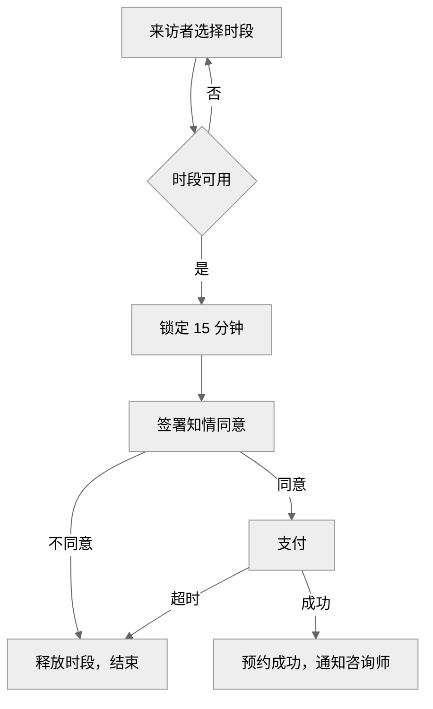
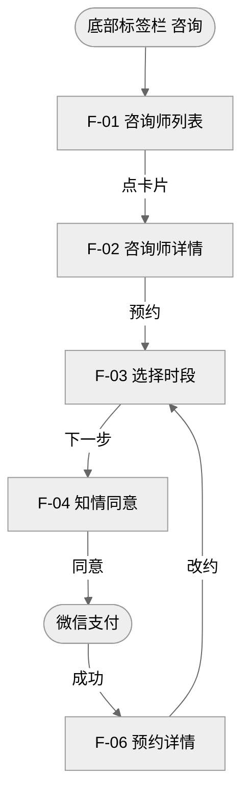
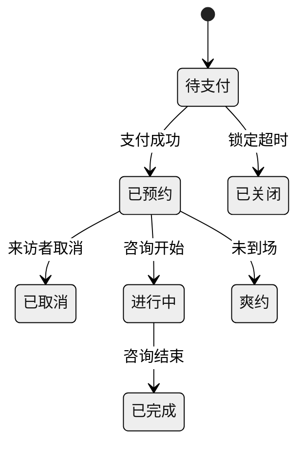
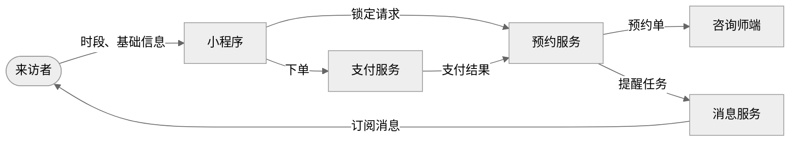
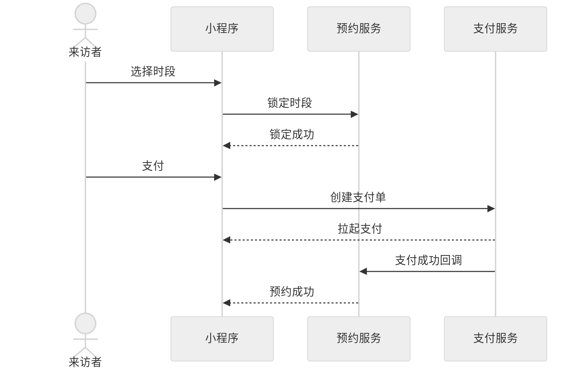

# 图：流程图、用户路径图、信息流转图、交互时序图、状态图

PRD 中的图都用 Mermaid 写在 `mermaid` 代码块里。

- 飞书：用飞书官方命令行工具 lark-cli 导入 Markdown 时，Mermaid 代码块会转成飞书画板，可以继续编辑。手动导入时用全包里渲染好的 PNG。
- 全包：`make_bundle.py` 把每张图渲染成 PNG，并放进 HTML 预览。
- 只要文本：直接输出代码块。

## 一、画哪些图

| 图 | 位置 | 画什么 | 什么时候画 |
| --- | --- | --- | --- |
| 业务流程图 | 8.2 | 角色和系统按什么顺序做什么，在哪里分支 | 有多步骤或多角色流程 |
| 用户路径图 | 8.3 | 页面之间怎么跳 | 新增或改动页面跳转 |
| 状态图 | 8.5 | 对象有哪些状态，怎么变 | 对象有 3 个及以上状态 |
| 信息流转图 | 8.8 | 数据在用户、页面、系统之间怎么流动 | 涉及 2 个及以上系统 |
| 交互时序图 | 8.8 | 一个关键流程中，各方按时间顺序的调用和回调 | 有跨系统调用、回调、异步通知 |

图就是这部分内容的唯一出处，不再另写步骤表、状态表或对接表。

## 二、通用规则

1. 第一行写 `%%{init: {"theme": "neutral"}}%%`，图只用黑白灰。
2. 节点编号用英文字母和数字，显示文字用中文，放在引号里：`A["选择时段"]`。
3. 页面节点以功能编号开头：`P3["F-03 选择时段"]`。
4. 连线上的文字写动作或条件，一到六个字：`-->|"支付成功"|`。
5. 一张图不超过 15 个节点；超过时按子流程拆图，图前写子流程名。
6. 不在图里写规则细节，规则写在 8.4、8.7，图里只到“做什么、去哪里”。
7. 图前用一行写图名，例如“首次预约流程”。

## 三、写法

### 业务流程图

- 开始和结束用普通方框，判断用菱形 `{}`。
- 多个角色时，节点文字以角色开头，如“支付服务回调”。

### 用户路径图

- 入口和外部页面用圆角 `([ ])`，本需求的页面用方框。
- 每个模块一张图；超过 5 个节点时用 `flowchart TD` 纵向排。

### 状态图

- 连线写触发条件；执行者不是系统时写成“来访者取消”。

### 信息流转图

- 人用圆角，系统用方框；连线写传递的数据，不写动作。

### 交互时序图

- 同步调用用 `->>`，返回和回调用 `-->>`。
- 一张图只画一个流程，参与方不超过 6 个。

## 四、检查

- 代码块语言写 `mermaid`，第一行是主题设置。
- 节点文字都在引号里，没有括号说明。
- 用户路径图中的页面都在 8.4 有同编号的小节。
- 状态图的状态名与字段表、页面中出现的状态名一致。
- 一个对象一张状态图，不用 state 嵌套把多个对象画在同一张图里，不同对象的同名状态会被合并。
