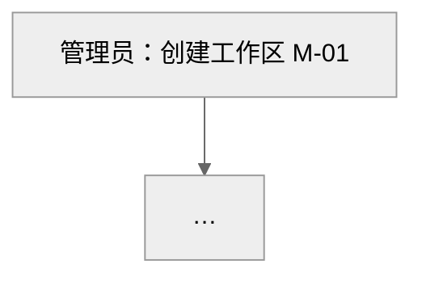

# 产品总纲模版

用于新产品模式的第一份文档。以 `> 写法：` 开头的引用块是写给你（AI）的说明，**输出时必须删除**。写作铁律与 SKILL.md 相同。总纲只写产品级内容，功能细节留给模块 PRD。

---

# 【产品名】产品总纲

这是什么产品，给谁用，第一版做到什么程度，一句话写完。

## 一、产品定位

- **一句话定位**：为【谁】提供【什么】，帮助他们【达成什么】。
- **目标用户**：主要用户与次要用户。
- **核心价值**：3 条以内。
- **典型使用场景**：3-5 个，编号 S-01 起。

## 二、背景与竞品参考

> 写法：竞品信息来自公开资料时写明来源，在第 2 步请用户确认；不编造竞品的数据（用户量、营收、价格）。用户提到“类似 XX”时，XX 必须出现在竞品表中。

- **要解决的问题**：
- **为什么现在做**：

| 竞品 | 定位 | 主要能力 | 优点 | 不足 | 我们的差异 |
| --- | --- | --- | --- | --- | --- |

## 三、产品目标

| 指标 | 类型 | 目标 | 时间 |
| --- | --- | --- | --- |
| | 北极星 / 阶段指标 / 护栏 | | |

- **非目标**：

## 四、用户角色与权限总览

> 写法：这里定义全产品的角色，模块 PRD 不新增角色。权限只写到模块级，细到功能的权限写在模块 PRD 的 8.6。

| 角色 | 说明 | 典型用户 |
| --- | --- | --- |

| 模块 | 角色 A | 角色 B | 角色 C |
| --- | --- | --- | --- |
| | 管理 / 使用 / 查看 / 无 | | |

## 五、功能模块地图

> 写法：先用缩进列表展示模块层级，再用表格列出模块清单。模块编号 M-01 起，模块 PRD 的功能编号以此为前缀。

- 【产品名】
    - M-01 模块名：一句话说明
    - M-02 模块名：一句话说明

| 编号 | 模块 | 包含的主要功能 | 优先级 | 首次出现版本 | 依赖模块 | PRD 状态 |
| --- | --- | --- | --- | --- | --- | --- |
| M-01 | | | P0 | MVP | — | 未开始 |

## 六、核心业务流程

> 写法：只写跨模块的主流程，每条一张 Mermaid 流程图，节点写“角色：动作”，并标模块编号；画法见 `diagrams.md`。模块内部流程留给模块 PRD。

## 七、核心对象与关系

> 写法：列出产品中最重要的业务对象，例如项目、任务、成员，让各模块使用统一的对象定义。关系用“属于 / 包含 / 关联”描述。主要对象的状态用 Mermaid 状态图画一次，详细规则写在模块 PRD。

| 对象 | 说明 | 关键属性 | 关系 | 所在模块 |
| --- | --- | --- | --- | --- |

**核心对象状态**：每个有状态的对象一张状态图。

## 八、全局与交互规范

> 写法：与 `prd-template.md` 第七章相同的两张表（7.1 全局业务规则 G-、7.2 通用交互规范 I-），但这里是全产品通用的版本，编号写成 8.1、8.2。所有模块 PRD 用链接引用这里，不重复。有共用的页面框架时，按 `wireframe.md` 在这里画一次框架线框图，作为 I-07。

## 九、MVP 与版本路线图

> 写法：MVP 只保留验证核心价值必需的模块和功能。每个版本写清楚目标，而不只是功能列表。

| 版本 | 目标 | 包含模块 / 功能 | 不包含 | 预计时间 |
| --- | --- | --- | --- | --- |
| MVP | | | | |
| V1 | | | | |
| V2 | | | | |

**模块 PRD 撰写顺序**：1. M-0X：原因　2. M-0X：原因

## 十、商业模式与部署

> 写法：可选。内部产品不写本章。

- **收费方式**：免费 / 订阅 / 按量 / 一次性买断 / 定制项目
- **部署方式**：SaaS / 私有化 / 两者都支持
- **套餐差异**：

## 十一、非功能需求总则

| 类别 | 要求 |
| --- | --- |
| 性能 | |
| 安全 | |
| 隐私与合规 | |
| 兼容性 | |
| 可用性 | |
| 多语言 | |

## 十二、团队与协作

| 角色 | 姓名 | 负责模块 | 备注 |
| --- | --- | --- | --- |
| 产品 | | | |
| 研发 | | | |
| 测试 | | | |
| 设计 | | | |
| 数据 | | | |
| 运营 | | | |
| 项目经理 | | | |

**外部依赖**：第三方服务、供应商、资质审批等。

## 十三、风险与依赖

| 类型 | 描述 | 影响 | 应对措施 | 负责人 |
| --- | --- | --- | --- | --- |

## 附录

**A. 名词解释**

**B. 附件**

**C. 版本记录**：格式同 `prd-template.md` 附录 C，“涉及章节”写受影响的模块编号。
